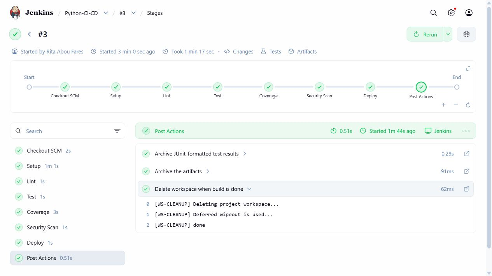
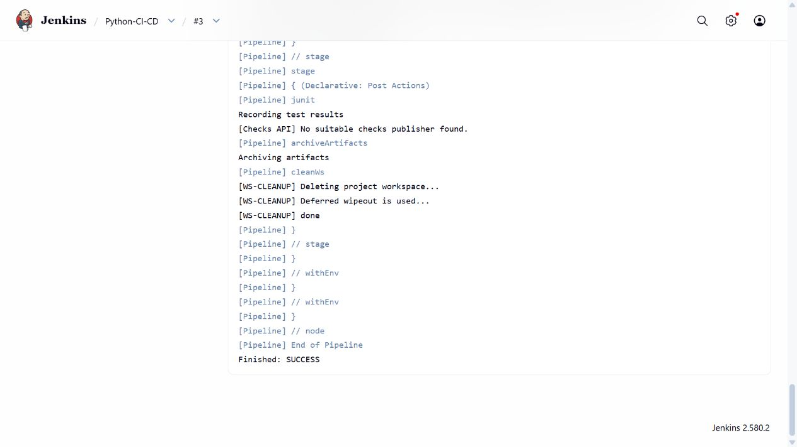

# Lab 10 Part 4 Report

**Student:** Rita Abou Fares  
**Project:** Python-CI-CD  
**Date:** 18 November 2026  
**Verified build:** Jenkins #3 — SUCCESS  
**Validated source revision:** `71710f668dc54b33077834ccb96eb914adb42cc6`

## Changes made

The Windows pipeline keeps the Setup, Lint and Test stages and adds the required
Coverage and Security Scan stages. The Deploy stage now performs a local
deployment instead of printing a placeholder message.

- **Coverage:** coverage.py runs the existing pytest test while measuring
  `app.py`, prints a report with missing lines, and produces `coverage.xml`.
- **Security Scan:** Bandit scans both `app.py` and `deploy.py`. Its normal
  nonzero exit status fails the pipeline if a security issue is found.
- **Deployment:** `deploy.py` copies `app.py` to a persistent local directory
  and verifies that the copied contents match the source. Jenkins then executes
  the deployed copy to verify its output. This directory is outside the build
  workspace, so `cleanWs()` does not remove the deployment.

The requirements file includes `flake8`, `pytest`, `coverage` and `bandit`.
JUnit results are published and the coverage and security reports are archived
before workspace cleanup.

## Build results

| Stage | Observed result |
|---|---|
| Setup | Dependencies installed successfully |
| Lint | No Flake8 errors in app.py or deploy.py |
| Test | 1 passed; 0 failed |
| Coverage | 4 statements; 1 missed; **75% coverage** |
| Security Scan | **No issues identified**; 24 lines scanned; 0 skipped files |
| Deploy | Copied application executed successfully |
| Final result | **Finished: SUCCESS** |

Coverage identifies line 6, the command-line print statement in `app.py`, as
uncovered by the current unit test. No minimum coverage percentage is specified
in the lab.

Bandit reported zero low-, medium- or high-severity issues, with no `nosec`
suppressions.

Deployment location:

```text
C:\Users\jenkins_rita\AppData\Local\Jenkins\.jenkins\deployments\jenkins_project\app.py
```

Output from the deployed application:

```text
Hello, World from Rita AbouFares!
```

Archived build artifacts are `coverage-report.txt`, `coverage.xml` and
`bandit-report.txt`.

## Evidence




